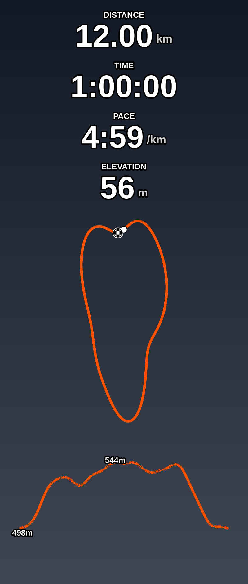
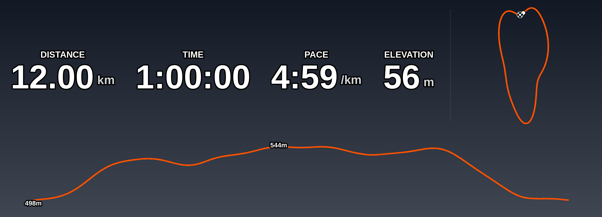
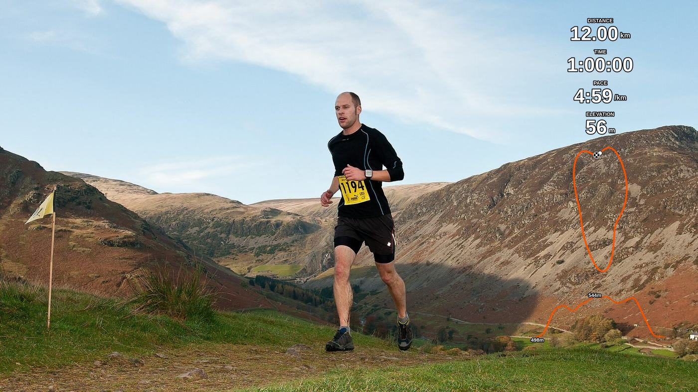
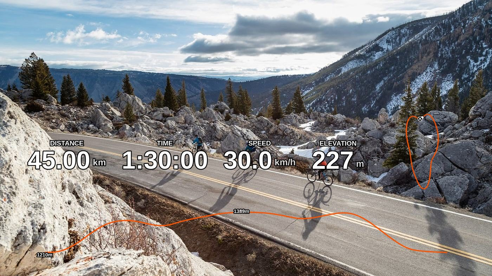
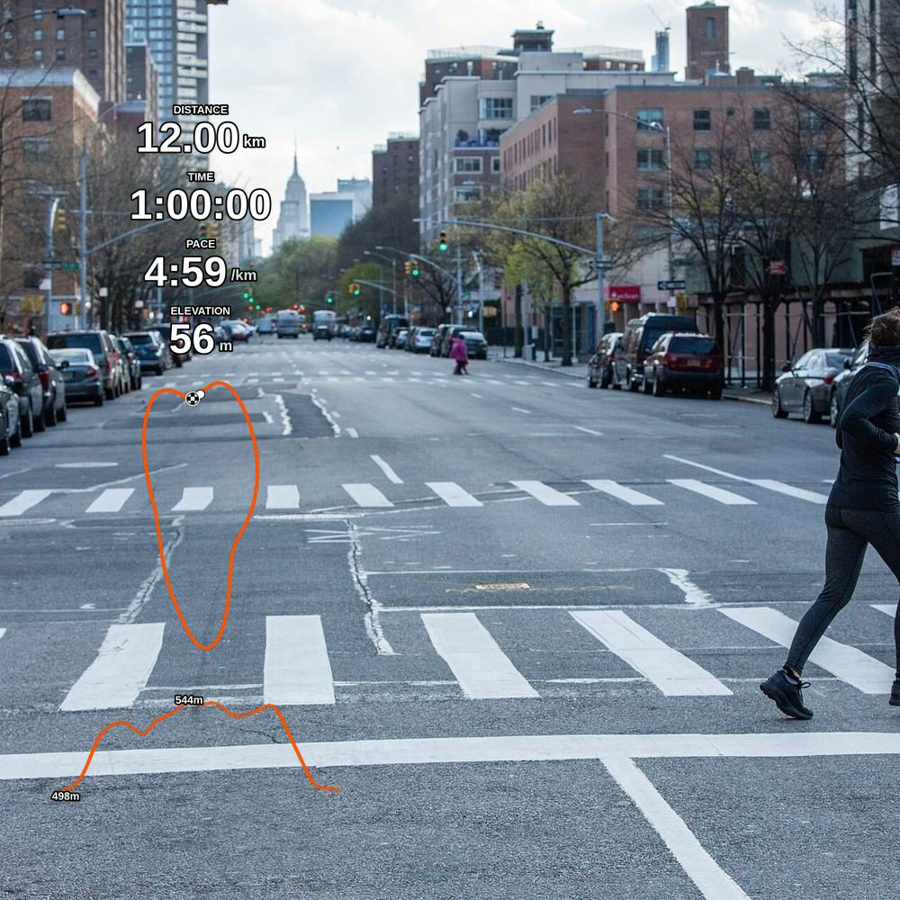

# running-card

Generate a transparent PNG card with running or cycling stats. The tool reads a
GPX or FIT file and draws the route and the elevation profile.

The card is made for overlay on a photo or a video. The background stays
transparent, and the text is white with a black outline.

## Examples

### Cards

These two cards come from `examples/demo.gpx`. The dark background is only for
the preview. The PNG file keeps a transparent background.

Vertical layout, `--width 800`:



Horizontal layout, `--layout h --width 3200 --height 700`:



### On a photo

These frames show the card on a real photo. The card is the same PNG file, so
it also goes into a video editor as an overlay. `make_examples.py` puts the
card on the photo with Pillow.

Trail run, vertical layout in the top right corner:



Road ride, `--metric speed` in the horizontal layout as a lower third:



City run, vertical layout in a square post for social media:



The example cards also use `--outline-width`. The outline keeps the text
readable on a light background. On a photo, `--outline-width 0` gives the text
without an edge.

### Files in `examples/`

1. `demo.gpx`: a 12 km run with 56 m of climb. The track is made up, not a real
   run.
2. `demo-ride.gpx`: a 45 km ride with 227 m of climb. The track is made up.
3. `vertical.png`, `horizontal.png`, and `horizontal-speed.png`: the cards,
   with a transparent background.
4. `vertical-preview.png` and `horizontal-preview.png`: the cards on a dark
   background.
5. `setup-trail.jpg`, `setup-cycling.jpg`, and `setup-city.jpg`: the cards on a
   photo.
6. `backgrounds/`: the photos without an overlay, cropped for the setups.
7. `make_examples.py`: builds the files again. Run
   `python examples/make_examples.py`.

### Photo credits

1. "Helvellyn Trail race" by Robin McConnell. Licensed under
   [CC BY 2.0](https://creativecommons.org/licenses/by/2.0), via
   [Wikimedia Commons](https://commons.wikimedia.org/wiki/File:Helvellyn_Trail_race.jpg).
   The photo is cropped.
2. "Cycling in Yellowstone National Park" by Jacob W. Frank. Public domain, via
   [Wikimedia Commons](https://commons.wikimedia.org/wiki/File:Cycling_in_Yellowstone_National_Park_%2839d83280-a4d0-44f8-9504-0ba6333dd955%29.jpg).
   The photo is cropped.
3. "Jogger Crosses Empty New York City Street During COVID19 Quarantine" by
   Anthony Quintano. Licensed under
   [CC BY 2.0](https://creativecommons.org/licenses/by/2.0), via
   [Wikimedia Commons](https://commons.wikimedia.org/wiki/File:Jogger_Crosses_Empty_New_York_City_Street_During_COVID19_Quarantine.jpg).
   The photo is cropped.

## What the card shows

The stats appear in this order:

1. Distance in kilometres.
2. Total time from the first to the last track point, as `HH:MM:SS` or
   `MM:SS`.
3. Pace in `min/km`, or speed in `km/h`.
4. Elevation gain in metres.
5. The GPS route, when the file has position data.
6. The elevation profile, when the file has altitude data.

## Layouts

The vertical layout stacks the stats from top to bottom. The route is a square
block below the stats. The elevation profile sits below the route.

The horizontal layout puts the stats in one row. Use it for wide banners and
video lower thirds. A thin separator line divides the stats from the route.

The route keeps its true shape in both layouts. The tool corrects the length of
a longitude degree for the latitude, so a route does not look stretched.

## Requirements

1. Python 3.10 or later.
2. Pillow.
3. fontconfig, on Linux, for the font fallback.
4. fitparse, only for FIT files.
5. A TrueType font. The tool tries Liberation, DejaVu, FreeFont, Noto, Arial,
   and Helvetica, in this order.

## Install

```
pip install Pillow
pip install fitparse    # only for FIT files
```

GPX files need no extra package. The GPX reader uses the Python standard
library.

## Use

Read a file:

```
python running-card.py my_run.gpx
python running-card.py my_run.fit
```

The tool writes `my_run.png` next to the input file. Use `--output` to set
another path.

Enter the stats by hand:

```
python running-card.py
```

The tool asks for the time, the distance, and the elevation gain. It writes
`running_card.png`.

Set the size and the layout:

```
python running-card.py my_run.gpx --layout h --width 1920 --height 600
python running-card.py my_run.fit --metric speed --width 1200
```

## Options

| Option | Value | Default | Effect |
| --- | --- | --- | --- |
| `FILE` | path | none | GPX or FIT file to read. When you omit it, the tool asks for the stats by hand. |
| `--metric` | `pace`, `speed` | `pace` | Shows pace in min/km or speed in km/h. Use `speed` for cycling. |
| `--layout` | `v`, `h` | `v` | Vertical or horizontal layout. |
| `--width` | pixels | 1200 for `v`, 3200 for `h` | Canvas width. |
| `--height` | pixels | auto | Canvas height. When you omit it, the tool calculates the height from the content. In the horizontal layout the route uses the full height, so this option also sets the size of the route. |
| `--distance-source` | `gps`, `footpod` | `footpod` | Distance source for FIT files. |
| `--pace-source` | `gps`, `footpod` | `footpod` | Pace source for FIT files. |
| `--ele-band` | metres | `1.0` | Elevation hysteresis band. See the note below. |
| `--outline-width` | pixels | `0` | Text outline width. `0` turns the outline off. |
| `--output` | path | input name with `.png` | Output PNG path. |

## Elevation gain

The tool does not add up each height change. A GPS track has small height
noise, and a simple sum adds this noise to the result. The tool counts a climb
only after the track rises above the last low point by a set band.

1. `--ele-band 1.0` matches Garmin Connect.
2. `--ele-band 8.0` matches the stronger noise filter of Runalyze, and gives a
   lower value.

## Colour and transparency

The route line and the elevation profile use Strava orange (`#FC5202`). The
route has a white start disc and a checkered finish disc. The text is white.
All other pixels are transparent, so you can place the PNG on any background,
and you can put it in a video editor as an overlay.

## Licence

MIT. See `LICENSE`.
